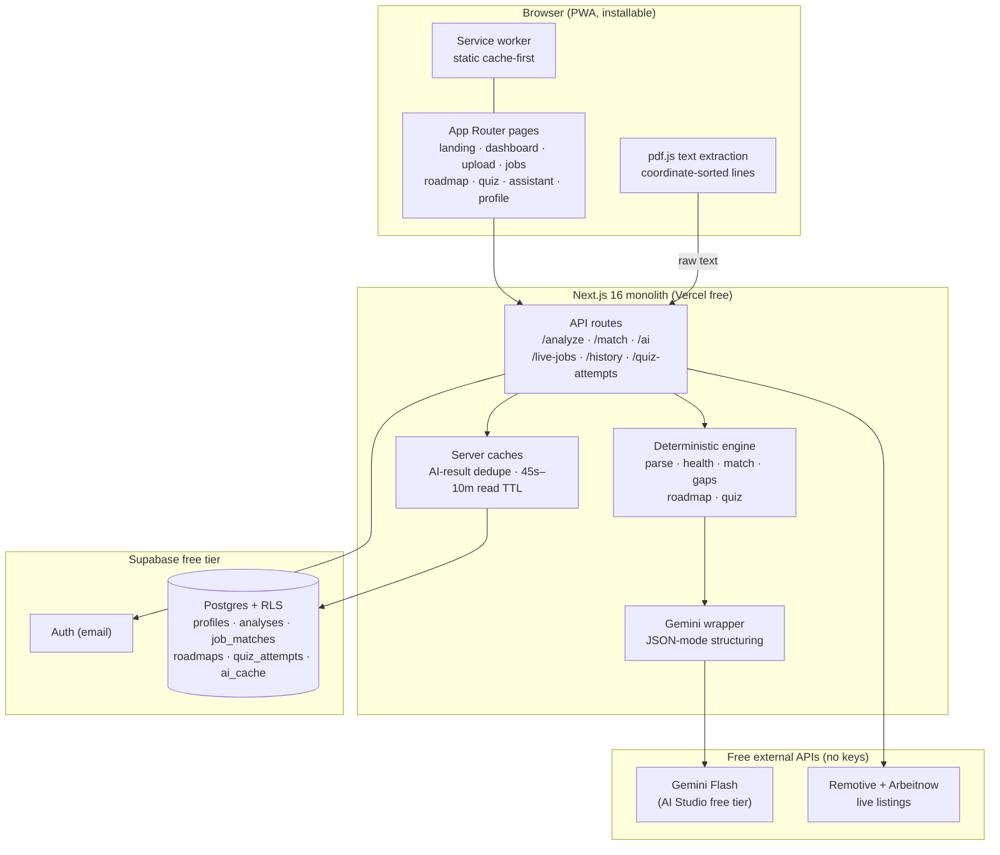
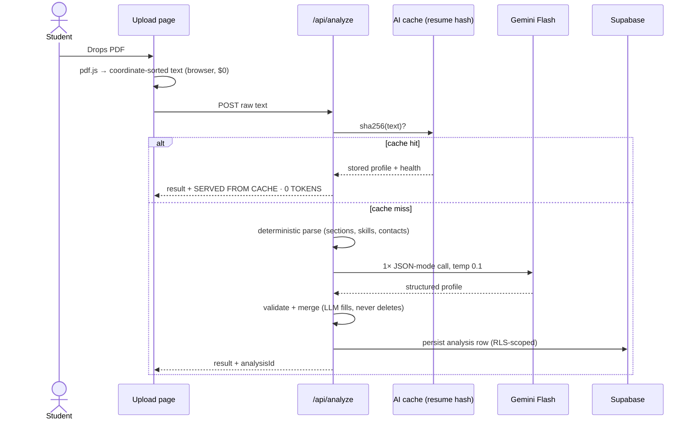

# ResumeAI — From PDF to Career Plan

> Upload one PDF. Get a health score, exact job-match percentages, missing skills with *why they matter*, a learn-first roadmap, a verification quiz, and a profile-aware assistant. Grounded in your real experience — never invented.

     

## What it does

| Area | Tools |
|---|---|
| Understand the resume | PDF upload + parsing, health score + weak-section fixes, candidate profile with honest skill levels |
| Match jobs | Job-match scoring, have / partial / missing skills, multi-job compare, **live job search** (no API key), what-if simulator, role recommendations, resume wording fixes |
| Close the gap | Per-job learning roadmaps, skill verification quizzes with topic picker, career assistant with saved sessions, readiness dashboard |

Every score is labelled decision-support or simulation — never a hiring verdict, never invented qualifications.

## System design





## Engineering that keeps it at $0/mo

**One monolith, zero paid services.** Next.js frontend + API routes deploy as a single Vercel Hobby app. Supabase free tier covers Auth + Postgres + file metadata. Everything else is engineered to avoid a bill:

| Cost center | How it's $0 |
|---|---|
| Resume parsing | `pdfjs-dist` runs **in the browser** — no Affinda/Textkernel per-resume fees. Visual lines are rebuilt from glyph coordinates (baseline grouping ±3pt), so multi-column resumes don't interleave |
| Embeddings / vector DB | Skipped entirely. A 20-skill canonical taxonomy with **word-boundary regex** matching (`ts`≠sports, `ml`≠html, `api`≠rapid, `go`≠ongoing) plus a short-token rule (1–2 letter tokens need skills-section context or 2+ mentions) beats naive substring search for free |
| LLM tokens | **Content-hash dedupe**: identical resume → stored analysis, identical skills+JD → stored match + strategy, identical profile → stored wording rewrite. Repeats cost 0 tokens and the UI badges it (`SERVED FROM CACHE · 0 TOKENS`) |
| DB reads | In-process TTL cache (45s–10min) on row fetches and history lists; writes bust their key prefixes. History via one cached endpoint (`/api/history?kind=`) |
| Job listings | Remotive (per-skill search) + Arbeitnow (bulk, filtered locally) — both free, no keys, fetched server-side with a 10-min cache |
| Hosting/auth/data | Vercel Hobby + Supabase free + Gemini AI Studio free tier (this repo defaults to the `gemini-flash-latest` alias so retired version pins can't 404 you — override with `GEMINI_MODEL`) |

## Prompting techniques

All prompts live in `lib/gemini.ts` and follow the same discipline:

1. **System guard on every call** — resume data is personal; never invent skills, qualifications or experience; scores are simulations/recommendations, never hiring guarantees.
2. **JSON-mode structuring, temperature 0.1** — the resume parse is a single `responseMimeType: "application/json"` call against a fixed schema (name, contacts, section arrays, skills, one-line summary). Low temperature + schema = stable output.
3. **Validate, then merge over deterministic** — every field is type-checked, length-capped and deduped; LLM arrays only replace empty ones, skills union, levels default to `beginner`. The model can fill gaps but never delete or contradict the parser.
4. **Deterministic-first, LLM-second** — match scores, gaps, roadmaps and quizzes are computed locally with transparent formulas (`(have + 0.5×partial) / JD skills`). Gemini only polishes wording (match strategy, bullet rewrites, summary) — so the app is fully useful with no key at all.
5. **Rule-based chat fallback** — without a key, the assistant answers from the parsed profile with grounded templates (gaps → learn order, jobs → fitted roles) instead of hallucinating.
6. **Batch, don't chat** — one strategy call per 3-JD batch, one summary embedded in the parse call. No multi-turn chains anywhere in the pipeline.

## Data isolation & cross-device sync

- Supabase Auth (email) gates every app page; signed-out visitors bounce to `/auth?next=…`.
- Every table is RLS owner-only (`auth.uid() = user_id`); the SQL in `supabase/schema.sql` drops legacy open policies first. **Re-run it after pulling — it adds `chat_sessions` and a `profiles_user_unique` constraint.**
- **Two-way sync, last-write-wins**: profile/resume pushes on every analyze + save and restores the newest copy on login (timestamp-compared against local edits, so offline work isn't clobbered); chats merge by id with newer-`updatedAt` winning and debounced pushes; matches, roadmaps and quiz attempts were already server-persisted with history lists. A green dot in the sidebar confirms cloud sync.
- Client state is namespaced per user (`resumeai_state_<uid>`); switching accounts swaps workspaces.
- Addressable, shareable results: `/jobs/[id]`, `/roadmap/[id]`, `/quiz/[id]` — all server-rendered and RLS-scoped.

## Quickstart

```bash
npm install
cp .env.example .env.local   # then fill in your keys
npm run dev                  # http://localhost:3000
```

| Variable | Required | Purpose |
|---|---|---|
| `NEXT_PUBLIC_SUPABASE_URL` | yes | Supabase project URL |
| `NEXT_PUBLIC_SUPABASE_PUBLISHABLE_KEY` | yes | Supabase publishable (anon) key |
| `GEMINI_API_KEY` | no | Google AI Studio key — unlocks AI structuring; app runs deterministically without it |
| `GEMINI_MODEL` | no | Defaults to `gemini-flash-latest` |
| `NEXT_PUBLIC_SITE_URL` | no | Canonical site URL for OG tags, sitemap and robots (defaults to localhost) |

Then run `supabase/schema.sql` in your Supabase SQL editor (tables + RLS + indexes) and enable the Email auth provider.

### Auth redirects (production)

Confirmation emails must land back on your domain, or users verify into the void:

1. **Supabase dashboard → Authentication → URL Configuration**: set **Site URL** to `https://resume-ai-five-weld.vercel.app` and add it to **Redirect URLs** as `https://resume-ai-five-weld.vercel.app/**` (keep `http://localhost:3000/**` for local dev).
2. **Vercel → Project → Settings → Environment Variables**: set `NEXT_PUBLIC_SITE_URL=https://resume-ai-five-weld.vercel.app` (canonical tags, OG image, sitemap and robots read it; the app falls back to Vercel's auto domain if unset).
3. The app handles the rest: sign-up links point at `/auth/callback`, which exchanges the code for a session and lands the user on `/dashboard`. Expired links bounce to `/auth?error=confirm` with a resend button.

## Project structure

```
app/                    App Router pages + API routes + PWA manifest hooks
  api/analyze|match|ai|live-jobs|history|quiz-attempts
  jobs/[id] roadmap/[id] quiz/[id]   saved-result routes
components/             shell (sidebar), loading skeletons, reveal, landing GSAP
lib/                    analysis (parser+scoring) · skills (taxonomy)
                        gemini (prompts) · server-db (persist+cache)
                        live-jobs · store (per-user state) · auth · pdf
utils/supabase/         browser/server/middleware clients
supabase/schema.sql     tables, RLS, indexes
public/                 PWA manifest, service worker, icons
PRODUCT.md DESIGN.md    product truth + visual system
```

## Scripts

```bash
npm run dev     # local dev (port 3000)
npm run build   # production build
npm start       # serve production build (how to test the PWA locally)
npm run lint    # eslint
```

## Contributing

Issues and PRs welcome. Keep the rules: no invented qualifications anywhere in prompts or UI, every AI result cached by content hash, free-tier-first for every new feature.

## License

MIT — see [LICENSE](LICENSE).
